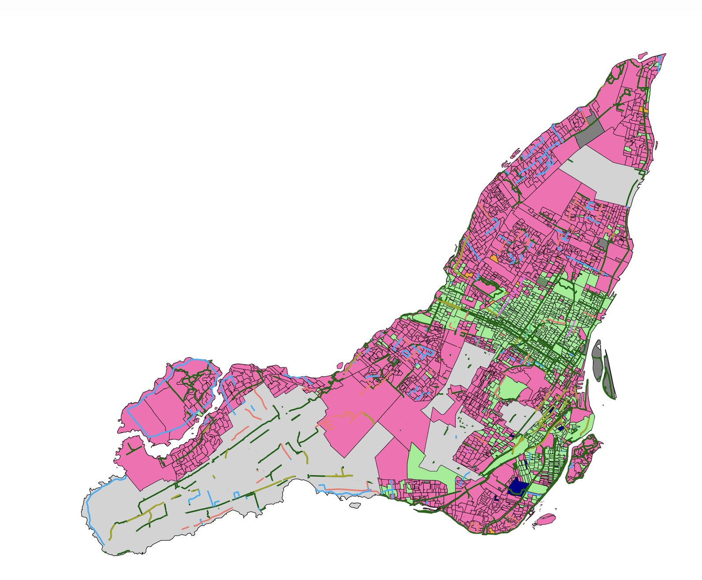
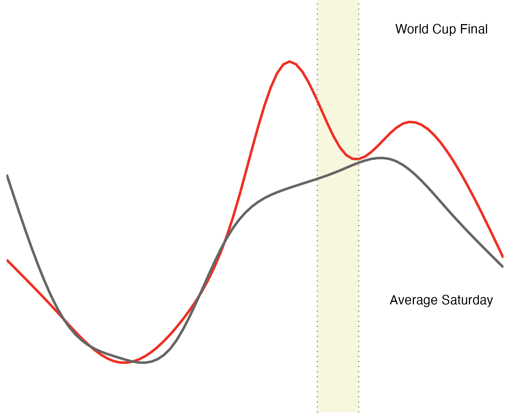
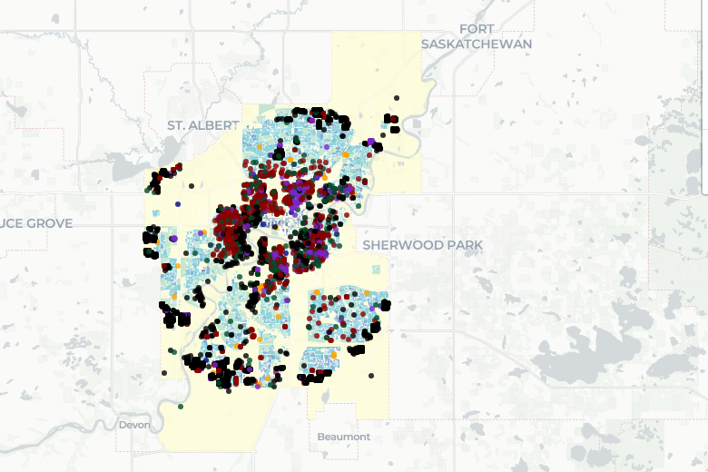

::::::: home

:::::: home-intro
::::: home-bio
[About]{.eyebrow}

# Rafael Campos-Gottardo

I am a quantitative and qualitative researcher with expertise in causal inference and spatial analysis who studies support for housing and housing policies in Canada. I currently work at the [Global Migration Institute](https://www.torontomu.ca/global-migration-institute/) at Toronto Metropolitan University, where I study [housing for international students](https://www.torontomu.ca/bridging-divides/research/research-projects/place-and-infrastructure/housing-for-international-students/) as part of Bridging Divides' Place and Infrastructure theme. I also examine individual level support for housing as part of a project with the Laurier Institute for the Study of Public Opinion and Policy ([LISPOP](https://scholars.wlu.ca/lispop/4/)), which I have written about in the [Waterloo Region Record](https://www.therecord.com/opinion/contributors/waterloo-s-housing-crisis-puts-densification-to-the-test/article_ec96d782-3b1c-58e7-a993-faf8aa6b744a.html).

I have previously contributed to the Canadian Election Study ([CES](http://www.ces-eec.ca)) and worked extensively as a research assistant for the Laurier Institute for the Study of Public Opinion and Policy ([LISPOP](https://lispop.ca)), Université du Québec à Montréal, and the Centre for the Study of Democratic Citizenship.

I received a Master's Degree in Political Science from [McGill University](https://www.mcgill.ca/politicalscience/) and a Bachelor's degree in Political Science from [Wilfrid Laurier University](https://students.wlu.ca/programs/arts/political-science/index.html).

::: home-links
[CV](files/static/cv.pdf){.btn .btn-outline-primary}
[GitHub](https://github.com/RafaelGottardo){.btn .btn-outline-primary}
[LinkedIn](https://www.linkedin.com/in/rafael-campos-gottardo/){.btn .btn-outline-primary}
[Bluesky](https://bsky.app/profile/rafaelgottardo.bsky.social){.btn .btn-outline-primary}
:::
:::::

::: home-photo
{fig-alt="Portrait of Rafael Campos-Gottardo on a Toronto street"}
:::
::::::

:::::: home-feature
::::: home-feature-title
[Featured research]{.eyebrow}

## Public support for new housing
:::::

::::: home-feature-body
With colleagues at LISPOP, I study how persuasive appeals, partisanship, housing status, and the built environment shape support for new housing developments, drawing on the 2022 Ontario General Election.

::: tags
[Housing policy]{.tag} [Public opinion]{.tag} [Ontario politics]{.tag}
:::

[Explore my research →](research.qmd){.arrow-link}
:::::
::::::

:::::: home-section
::::: section-header
:::: {}
[Selected work]{.eyebrow}

## Projects
::::

[See all projects →](projects.qmd){.arrow-link}
:::::

::::: project-cards
:::: project-card
[{fig-alt="Map of the 2025 Montreal election results by polling station"}](montreal_election.qmd)

### [Mapping the 2025 Montreal Election](montreal_election.qmd)

Results by polling station, with bike lanes, green alleys, and on-street parking.
::::

:::: project-card
[{fig-alt="Line chart comparing BIXI trips during the World Cup final with an average Saturday"}](bixi-world-cup.qmd)

### [BIXI and the World Cup](bixi-world-cup.qmd)

How the World Cup changed bike-share use in Montreal.
::::

:::: project-card
[{fig-alt="Map of Edmonton showing building permits over census blocks"}](edmonton_infill.qmd)

### [Permits for Edmonton Infill](edmonton_infill.qmd)

Where new infill is being built, by census block and zone.
::::
:::::
::::::

:::::: home-section
::::: section-header
:::: {}
[Public engagement]{.eyebrow}

## Writing and commentary
::::

[See all →](engagement.qmd){.arrow-link}
:::::

::::: engagement-cards
:::: engagement-card
[Edmonton Journal · Oct 2026]{.card-kicker}

### [Blanket infill rollback ignores differences in Edmonton neighbourhoods](https://edmontonjournal.com/opinion/columnists/opinion-infill-blanket-rollback)

An op-ed with Kael Kropp: Edmonton's neighbourhoods are changing at very different rates, and its housing policies should reflect those differences.
::::

:::: engagement-card
[Waterloo Region Record]{.card-kicker}

### [Waterloo's housing crisis puts densification to the test](https://www.therecord.com/opinion/contributors/waterloo-s-housing-crisis-puts-densification-to-the-test/article_ec96d782-3b1c-58e7-a993-faf8aa6b744a.html)

An op-ed drawing on our LISPOP research on public support for housing.
::::

:::: engagement-card
[Substack]{.card-kicker}

### [Thoughts at the End of the Mile](https://rafaelcg01.substack.com/)

A Substack about Montreal politics, planning, and history.
::::
:::::
::::::

:::::::
